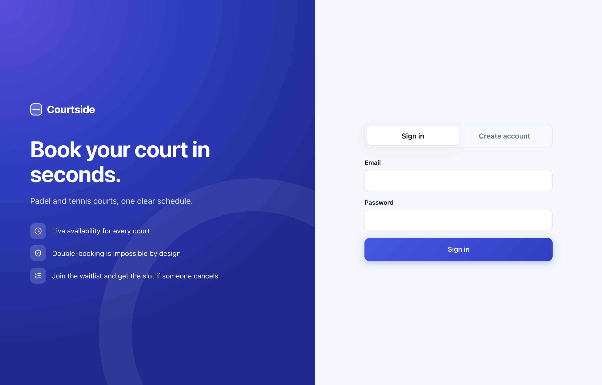
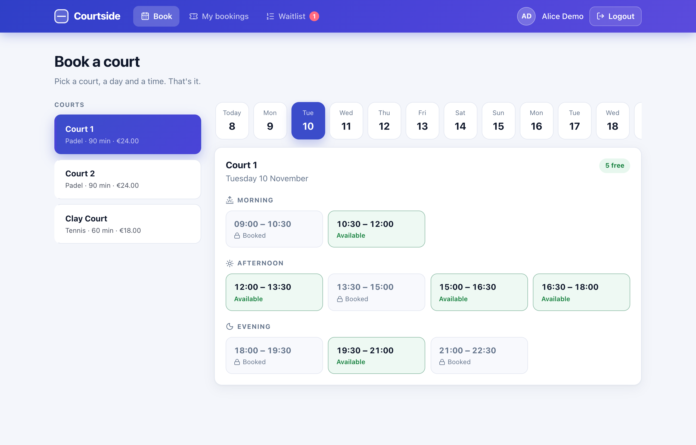
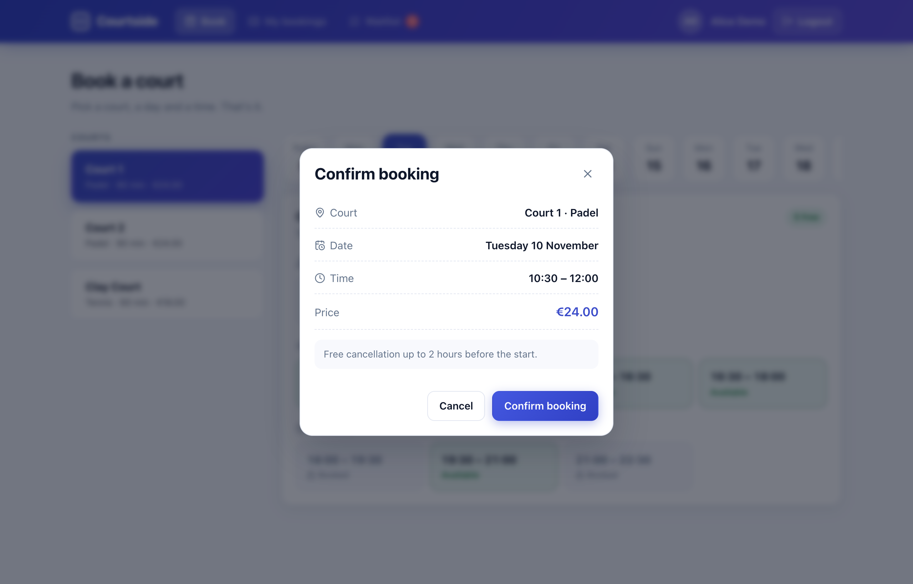
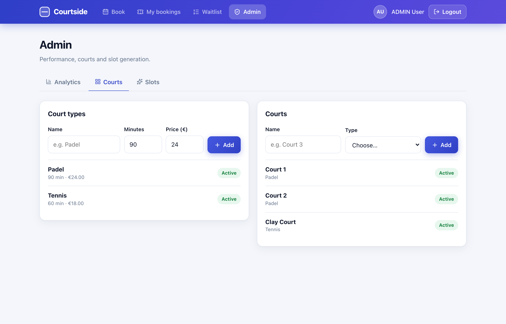
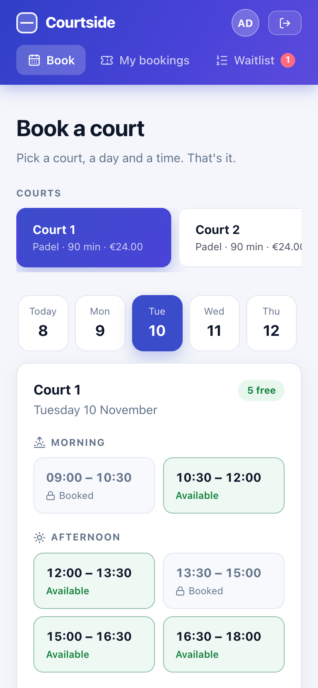

<div align="center">

# 🎾 Court Booking System

**A full-stack booking platform for padel & tennis courts, built so that two people can never book the same slot.**

Spring Boot · PostgreSQL · React · JWT Authentication

[](https://www.oracle.com/java/)
[](https://spring.io/projects/spring-boot)
[](https://react.dev/)
[](https://vitejs.dev/)
[](https://www.postgresql.org/)
[](https://flywaydb.org/)
[](https://www.docker.com/)
[](https://testcontainers.com/)
[](#-license)

</div>

---

## 🖼️ Screenshots

<p align="center"><i>All screens below are pulled directly from <code>/assets</code>. Click any image to view it at full resolution.</i></p>
<p align="center"><a href="#-overview">Jump to full documentation ↓</a></p>

### 🔑 Authentication

<table>
<tr>
<td width="50%" align="center">
<a href="assets/01-login-screen.png"></a>
<br/><sub><b>Login screen</b> — sign in or create an account (JWT-based)</sub>
</td>
</tr>
</table>

### 👤 Player — Booking

<table>
<tr>
<td width="50%" align="center">
<a href="assets/02-book-court.png"></a>
<br/><sub><b>Book a court</b> — pick a court and a day, slots grouped by morning / afternoon / evening</sub>
</td>
<td width="50%" align="center">
<a href="assets/03-booking-modal.png"></a>
<br/><sub><b>Confirm booking</b> — summary and price; sends an <code>Idempotency-Key</code> so a double-click never books twice</sub>
</td>
</tr>
<tr>
<td width="50%" align="center">
<a href="assets/04-my-bookings.png"></a>
<br/><sub><b>My bookings</b> — upcoming and history, cancel up to 2 hours before the start</sub>
</td>
<td width="50%" align="center">
<a href="assets/05-waitlist-offer.png"></a>
<br/><sub><b>Waitlist offer</b> — it's your turn: 30-minute countdown and a notification</sub>
</td>
</tr>
</table>

### 🛠️ Admin

<table>
<tr>
<td width="50%" align="center">
<a href="assets/06-admin-analytics.png"></a>
<br/><sub><b>Analytics</b> — occupancy per court and the most popular start times</sub>
</td>
<td width="50%" align="center">
<a href="assets/07-admin-courts.png"></a>
<br/><sub><b>Court management</b> — create court types and courts, activate / deactivate</sub>
</td>
</tr>
</table>

### 🎨 Dark Mode & Mobile

<table>
<tr>
<td width="50%" align="center">
<a href="assets/08-dark-mode.png"></a>
<br/><sub><b>Dark mode</b> — follows the system theme</sub>
</td>
<td width="50%" align="center">
<a href="assets/09-mobile.png"></a>
<br/><sub><b>Mobile</b> — fully responsive down to phone width</sub>
</td>
</tr>
</table>

---

## 📖 Overview

**Court Booking System** solves one concrete problem: what happens when two people click "Book" on the same court slot at the same moment? A naive implementation double-books. This project makes that impossible, and proves it with automated tests that run against a real PostgreSQL.

The system is split into two independently deployable pieces that talk to each other over a REST API:

- A **Spring Boot backend** exposing a secured REST API, backed by **PostgreSQL** with version-controlled schema migrations (**Flyway**). It handles authentication, booking with pessimistic locking, slot generation, a waitlist with asynchronous notifications, idempotent requests and admin analytics.
- A **React (Vite) frontend**, a single-page app with two experiences: players who book courts and admins who manage courts and read analytics.

Everything below, every screen, every endpoint, every table reflects what is actually implemented in this repository.

---

## 🧑‍🤝‍🧑 Roles & Permissions

Authorization is role based and enforced via Spring Security using a JWT bearer token. Every authenticated request carries a `ROLE_USER` or `ROLE_ADMIN` authority.

| Role | Can do |
|---|---|
| 👤 **USER** (player) | Register · log in · browse courts and live slot availability · book a slot · cancel a booking (not within 2 h of the start) · join / leave the waitlist of a taken slot · claim a waitlist offer · read their notifications |
| 🛠️ **ADMIN** | Everything a USER can do, **plus**: create / update court types and courts (soft-disable, no deletes) · trigger slot generation on demand · view occupancy and popularity analytics |

The first admin is created on startup from environment variables (idempotent, never hardcoded).

---

## ✨ Features

### 🔒 Concurrency & Correctness
- **Pessimistic locking** (`SELECT … FOR UPDATE` on the slot row) inside the booking transaction, followed by an existence check for a `CONFIRMED` booking.
- **Defense in depth:** a partial unique index `booking(slot_id) WHERE status = 'CONFIRMED'` makes the database itself refuse a second confirmed booking, even if the application logic were bypassed.
- **Idempotent bookings:** an optional `Idempotency-Key` header is stored in the **same transaction** as the booking and re-checked **under the slot lock**, so concurrent duplicates replay instead of failing. Reusing a key for a different slot is rejected.
- Every operation that decides who may get a slot (book, cancel, join, leave, expire an offer) takes the **same slot lock first, in the same order**, so operations are serialized and cannot deadlock.

### 🔐 Authentication & Security
- Stateless **JWT** access tokens (`jjwt`, HS256) plus **rotating refresh tokens**, stored only as SHA-256 hashes and never as JWTs.
- Custom `OncePerRequestFilter` (`JwtAuthenticationFilter`) populates the Spring Security context; passwords are hashed with **BCrypt**.
- Every secret comes from an environment variable. There are no defaults for the database password, JWT secret or admin credentials, and the JWT secret must be at least 32 bytes.
- Consistent JSON error responses through a global exception handler (`401`, `403`, `404`, `409`, validation errors with field details).

### 🗓️ Courts & Slots
- Court types (duration, price) and courts, **soft-disabled** with `isActive` rather than deleted.
- **Concrete slots** with a unique `(court, date, start time)`; availability is derived from the absence of a `CONFIRMED` booking.
- A **scheduled job** (on startup and nightly) keeps 14 days of slots available. It is idempotent, skips slots already in the past and is configurable (opening hours, horizon, cron).

### ⏳ Waitlist & Notifications
- When a booked slot is cancelled, the **first person in line (FIFO)** gets an exclusive 30-minute offer; nobody else can book it meanwhile.
- A scheduled job expires unclaimed offers and passes them to the next person.
- Notifications are published as events **after commit** and delivered **asynchronously** (`@Async`), behind a `NotificationSender` **Strategy** interface (database + logging senders included). Adding e-mail or push means adding one more component.

### 📊 Admin Analytics
- **Occupancy rate per court** and **most popular start times** for any date range (default: last 30 days), computed with JPQL projections and a `LEFT JOIN` so unbooked slots are counted.

### 🎨 Frontend
- Booking flow, bookings list, live waitlist countdown and an admin area with charts.
- Access tokens are refreshed silently shortly before they expire.
- Light and dark theme follow the system; layout works down to phone width.

---

## 🏗️ Tech Stack

| Layer | Technology |
|---|---|
| **Language** | Java 17 |
| **Backend framework** | Spring Boot 4.1 (Web, Data JPA, Security, Validation) |
| **Database** | PostgreSQL 16 |
| **Migrations** | Flyway (`flyway-core` + `flyway-database-postgresql`), Hibernate set to `validate` |
| **Auth** | JWT (`jjwt-api` / `jjwt-impl` / `jjwt-jackson` 0.12.6) |
| **Boilerplate** | Lombok |
| **Testing** | JUnit 5 · AssertJ · Awaitility · Testcontainers (PostgreSQL 16) |
| **Frontend framework** | React 18 |
| **Routing** | React Router DOM 6 |
| **Build tool** | Vite 5 |
| **HTTP client** | Axios |
| **Icons** | lucide-react |
| **Styling** | Plain CSS with design tokens, dark mode, responsive layout |
| **Containerization** | Docker / Docker Compose (multi-stage builds: database + backend + frontend served by nginx) |

---

## 📁 Project Structure

```
court-booking-system/
├── assets/                          # README screenshots
├── docker-compose.yaml              # Database + backend + frontend, one command
├── .env.example                     # Required environment variables (placeholders only)
├── backend/                         # Spring Boot REST API
│   ├── Dockerfile                    # Multi-stage Maven build -> slim JRE image
│   ├── src/main/java/com/nikoskatrakoulis/courtbookingsystem/
│   │   ├── config/                   # SecurityConfig, AdminSeeder, Async/Scheduling config
│   │   ├── controller/               # Auth, Booking, Court, CourtType, Slot, Waitlist, Notification, Admin*
│   │   ├── dto/                      # request / response objects
│   │   ├── entity/                   # JPA entities (Court, Slot, Booking, WaitlistEntry, IdempotencyKey...)
│   │   ├── event/                    # UserNotificationEvent + after-commit async listener
│   │   ├── exception/                # Domain exceptions + GlobalExceptionHandler
│   │   ├── notification/             # NotificationSender strategy + implementations
│   │   ├── repository/               # Spring Data JPA repositories (+ projection/)
│   │   ├── security/                 # JwtAuthenticationFilter
│   │   └── service/                  # Booking, Waitlist, SlotGeneration, Analytics, Jwt, User services
│   ├── src/main/resources/
│   │   ├── application.properties
│   │   └── db/migration/             # V1...V3 Flyway SQL migrations
│   └── src/test/                     # Integration tests on real PostgreSQL (Testcontainers)
└── frontend/                        # React (Vite) SPA
    ├── src/
    │   ├── api/                      # Axios client with silent token refresh
    │   ├── components/               # Layout, shared UI (Modal, Pill, Empty...)
    │   ├── context/                  # AuthContext, ToastContext
    │   ├── hooks/                    # useFetch
    │   ├── pages/                    # Login, Book, MyBookings, Waitlist, Admin
    │   ├── utils/                    # date and money formatting
    │   ├── App.jsx
    │   └── main.jsx
    ├── Dockerfile                    # Node build -> nginx
    ├── nginx.conf                    # SPA fallback + /api proxy to the backend
    ├── index.html
    ├── vite.config.js
    └── package.json
```

---

## 🚀 Getting Started

### Prerequisites

- [Docker](https://www.docker.com/) & Docker Compose (all you need to run the app)
- [Java 17+](https://adoptium.net/) and [Node.js 20+](https://nodejs.org/) only for local development

### 1. Clone the repository

```bash
git clone https://github.com/NikosKatrakoulis/court-booking-system.git
cd court-booking-system
```

### 2. Configure environment variables

```bash
cp .env.example .env
```

Open `.env` and fill in real values. Generate strong secrets with:

```bash
openssl rand -base64 24   # DB_PASSWORD
openssl rand -base64 48   # JWT_SECRET
```

> ⚠️ `.env` is git-ignored. Never commit real secrets. `docker compose` refuses to start without `DB_PASSWORD`, and the app refuses to start without the required variables.

| Variable | Required | Notes |
|---|---|---|
| `DB_PASSWORD` | yes | no default |
| `JWT_SECRET` | yes | at least 32 bytes |
| `ADMIN_EMAIL`, `ADMIN_PASSWORD` | yes | first admin, created only if the email does not exist yet |
| `DB_USERNAME`, `DB_URL` | no | default `courtuser` and the local docker database |
| `TZ` | no | backend container time zone, default `Europe/Athens` |
| `JWT_ACCESS_EXPIRATION`, `JWT_REFRESH_EXPIRATION` | no | milliseconds; default 15 min / 7 days |
| `SLOTS_OPENING_TIME`, `SLOTS_CLOSING_TIME`, `SLOTS_HORIZON_DAYS` | no | default `09:00`, `23:00`, `14` |
| `WAITLIST_OFFER_MINUTES` | no | default `30` |
| `IDEMPOTENCY_RETENTION_HOURS` | no | default `24` |

### 3. Start everything with Docker

```bash
docker compose up --build -d
```

The first build takes a few minutes. Then open:

- **App:** `http://localhost:3000`
- **API:** `http://localhost:8080`

Sign in with the `ADMIN_EMAIL` / `ADMIN_PASSWORD` from your `.env`, or create a normal account on the login screen. Stop everything with `docker compose down` (your data stays in the `pgdata` volume; add `-v` to wipe it).

The database is published on `127.0.0.1:5436` only. The backend container uses the `TZ` variable (default `Europe/Athens`) for slot hours and "in the past" checks.

### Alternative: local development (hot reload)

Run only the database in Docker and the apps on your machine.

#### Start the database

```bash
docker compose up -d db
```

#### Run the backend

```bash
set -a; source .env; set +a      # Spring Boot does not read .env by itself
cd backend
./mvnw spring-boot:run
```

Flyway applies all migrations on startup, the admin user is seeded from `ADMIN_EMAIL` / `ADMIN_PASSWORD`, and slots are generated for existing courts. The API is available at **`http://localhost:8080`**.

> In IntelliJ, put the same variables in the Run Configuration instead.

#### Run the frontend

```bash
cd frontend
npm install
npm run dev
```

The SPA is available at **`http://localhost:5173`**. Vite proxies `/api` to `localhost:8080`, so no CORS setup is needed. Sign in with your admin credentials to create courts, or register a normal account on the login screen.

---

## 🔌 API Reference

Errors share one JSON shape (`timestamp`, `status`, `error`); validation errors list the failing fields.

### Auth

| Method | Endpoint | Description |
|---|---|---|
| `POST` | `/api/auth/register` | Create a player account |
| `POST` | `/api/auth/login` | Returns `accessToken` + `refreshToken` |
| `POST` | `/api/auth/refresh` | Rotate the refresh token and get a new access token |
| `POST` | `/api/auth/logout` | Revoke the refresh token |
| `GET` | `/api/users/me` | Current user profile |

### Courts & Slots

| Method | Endpoint | Description |
|---|---|---|
| `GET` | `/api/court_types` · `/api/court_types/{id}` | List / get court types |
| `POST` · `PATCH` | `/api/court_types` · `/api/court_types/{id}` | Create / partially update a court type *(admin)* |
| `GET` | `/api/courts` · `/api/courts/{id}` | List / get courts |
| `POST` · `PATCH` | `/api/courts` · `/api/courts/{id}` | Create / partially update a court *(admin)* |
| `GET` | `/api/courts/{courtId}/slots?date=YYYY-MM-DD` | Slots of a day with availability |

### Bookings

| Method | Endpoint | Description |
|---|---|---|
| `POST` | `/api/bookings` | Book a slot, body `{"slotId": 1}`; optional `Idempotency-Key` header |
| `GET` | `/api/bookings` | My bookings, each with a server-computed `cancellable` flag |
| `PATCH` | `/api/bookings/{id}` | Cancel a booking (not within 2 h of the start) |

### Waitlist & Notifications

| Method | Endpoint | Description |
|---|---|---|
| `POST` | `/api/slots/{slotId}/waitlist` | Join the waitlist of a taken slot |
| `GET` | `/api/waitlist` | My active waitlist entries |
| `DELETE` | `/api/waitlist/{id}` | Leave the waitlist |
| `GET` | `/api/notifications` | My notifications |

### Admin

| Method | Endpoint | Description |
|---|---|---|
| `POST` | `/api/admin/slots/generate` | Generate slots now *(admin)* |
| `GET` | `/api/admin/analytics/occupancy?from=&to=` | Booked vs total slots per court *(admin)* |
| `GET` | `/api/admin/analytics/popular-slots?from=&to=&limit=` | Most booked start times *(admin)* |

---

## 🗄️ Database Schema & Migrations

The schema is owned by **Flyway** (`ddl-auto=validate`), so the entities and the migrations are checked against each other on every startup. Migrations live in `backend/src/main/resources/db/migration`:

| Migration | Purpose |
|---|---|
| `V1__init_schema.sql` | Core schema: court types, courts, slots, users, bookings, refresh tokens, plus the partial unique index that prevents double-booking |
| `V2__waitlist_and_notifications.sql` | Waitlist entries (one active entry per user and slot, at most one open offer per slot) and notifications |
| `V3__idempotency_keys.sql` | Idempotency keys, unique per user and key |

---

## 🧪 Testing

```bash
cd backend && ./mvnw test      # needs Docker: Testcontainers starts PostgreSQL 16
```

**35 integration tests** run against a **real PostgreSQL** rather than H2, because row locking, partial indexes and the Flyway migrations are PostgreSQL-specific.

- `BookingConcurrencyTest`: 8 threads released together with a `CountDownLatch` race for one slot; exactly one succeeds. It was verified to **fail when the lock is removed**, and a second test proves the database index rejects a double-booking on its own.
- `WaitlistServiceTest`: FIFO offers, expiry, leaving, asynchronous notification, and a race between the offered user and five outsiders.
- `IdempotencyTest`: six concurrent identical requests produce one booking and zero errors (also verified to fail without the under-lock re-check).
- Booking and cancellation rules, slot generation and analytics queries.

---

## ⚠️ Known Limitations

- No HTTP-level (MockMvc) tests and no frontend component tests; controllers, security rules and the UI flows were verified manually.
- Notifications are stored and logged only (no real e-mail).
- Only successful booking requests are stored under their idempotency key; a retried failure simply re-executes.
- An expired waitlist offer is released at the next job run (every minute), but it already stops blocking other users immediately.

---

## 🤝 Contributing

Contributions are welcome! To contribute:

1. Fork the repository
2. Create a feature branch (`git checkout -b feature/amazing-feature`)
3. Commit your changes (`git commit -m 'Add some amazing feature'`)
4. Push to the branch (`git push origin feature/amazing-feature`)
5. Open a Pull Request

---

## 📄 License

This project is licensed under the [MIT License](LICENSE).

---

## 👤 Author

**Nikos Katrakoulis**
[GitHub @NikosKatrakoulis](https://github.com/NikosKatrakoulis)
