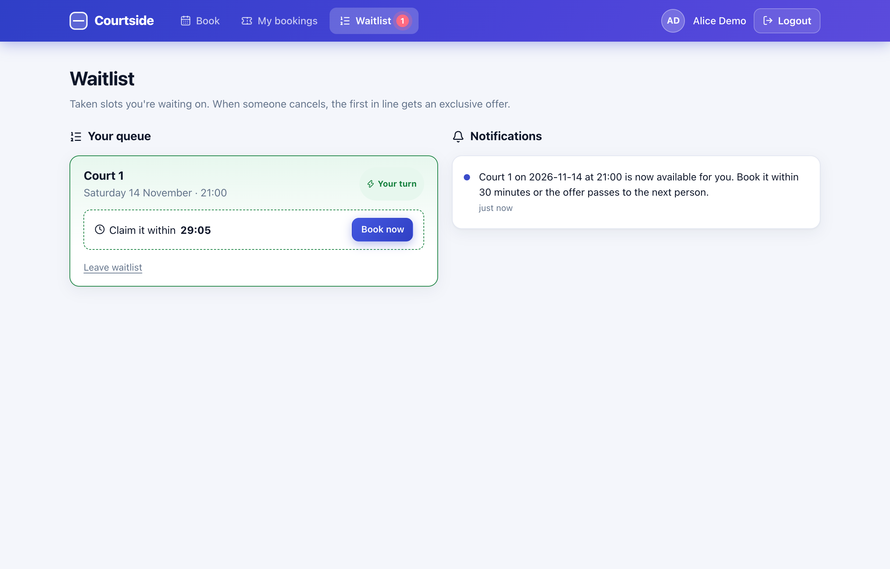
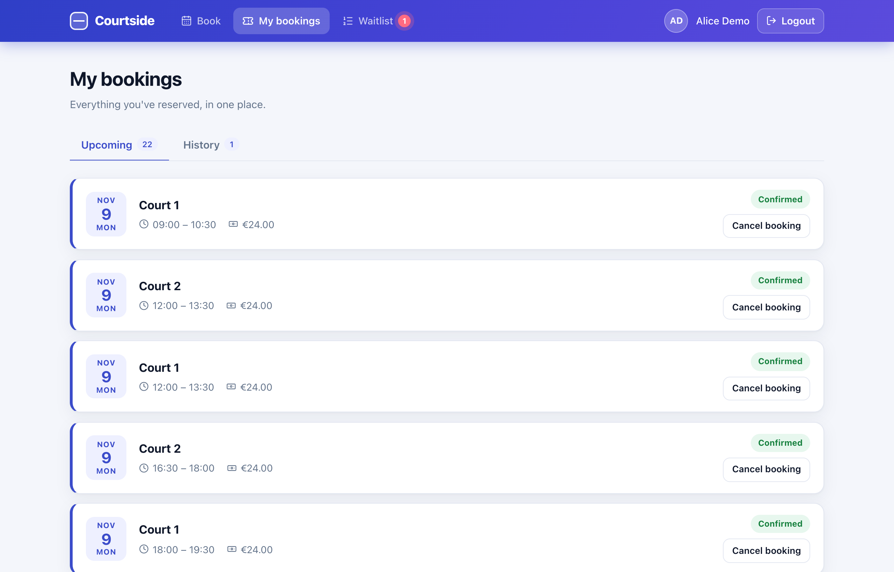
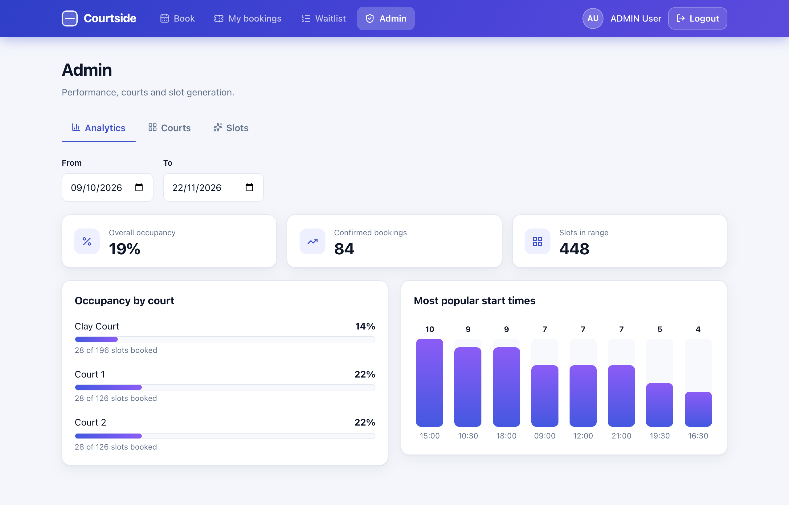
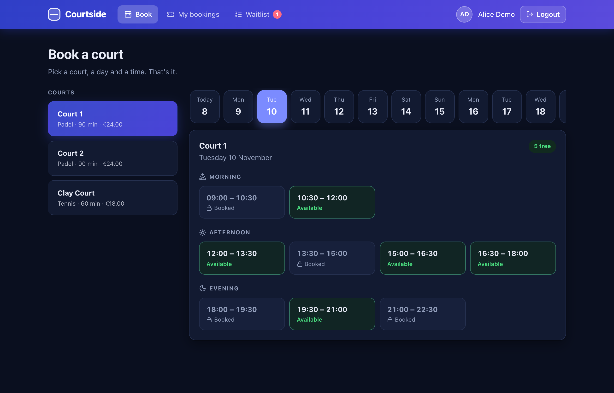

# Court Booking System

REST API for booking padel / tennis courts. The interesting part is **correctness under concurrency**: when many users try to book the same slot at the same moment, exactly one wins, and this is verified by automated tests against a real PostgreSQL.

**Stack:** Spring Boot REST API + React single-page app (`backend/` and `frontend/`).

<p align="center">
  
  
</p>

## Features

- **Booking** of concrete time slots per court, with a cancellation rule (no cancelling less than 2 hours before the slot).
- **Double-booking prevention** with pessimistic locking, backed by a database-level safety net.
- **JWT authentication** (short-lived access token + rotating, hashed refresh token) with `USER` and `ADMIN` roles.
- **Automatic slot generation**: a scheduled job keeps 14 days of slots available per court.
- **Waitlist**: when a booked slot is cancelled, the first person in line gets a 30-minute exclusive offer and is notified asynchronously. Unclaimed offers expire and pass to the next person.
- **Idempotent booking**: send an `Idempotency-Key` header and retries/double-clicks never create a second booking.
- **Admin analytics**: court occupancy rate and most popular start times.

## Tech stack

Backend: Java 17 · Spring Boot 4.1 (Web, Data JPA, Security, Validation) · PostgreSQL 16 · Flyway · JJWT · Docker Compose · JUnit 5 · Testcontainers · AssertJ · Awaitility

Frontend: React 18 · Vite · React Router · Axios · plain CSS (design tokens, dark mode, responsive)

## How concurrency is handled

| Problem | Mechanism |
|---|---|
| Two users book the same slot simultaneously | `SELECT ... FOR UPDATE` on the slot row (`PESSIMISTIC_WRITE`) inside the booking transaction, then check for an existing `CONFIRMED` booking |
| Application bug bypasses the lock | Partial unique index `booking(slot_id) WHERE status = 'CONFIRMED'`: the database itself refuses a second confirmed booking |
| Cancel racing with join/leave/book on the waitlist | Every operation that decides who may get a slot takes the **same slot lock first**, always in the same order, so operations are serialized and cannot deadlock |
| Double-click / client retry | `Idempotency-Key` stored in the **same transaction** as the booking and re-checked **under the slot lock**, so concurrent duplicates replay instead of failing |
| Two app instances generating slots at once | `UNIQUE (court_id, date, start_time)` |

Why pessimistic and not optimistic locking? Contention on a popular slot is expected and a lost race should be resolved by waiting, not by retrying after an exception. Locks are held for a very short transaction.

## Architecture

Package by layer: `controller` → `service` → `repository`, plus `entity`, `dto`, `exception`, `config`, `security`, `event`, `notification`.

```
cancelBooking ── lock slot ──▶ booking CANCELLED ──▶ offer slot to first WAITING user (FIFO, 30 min)
                                                          │ event published
                                                          ▼  after commit, @Async
                                            NotificationSender implementations   (Strategy pattern)
                                            ├─ DatabaseNotificationSender  (GET /api/notifications)
                                            └─ LoggingNotificationSender
```

Adding e-mail or push means adding one more `NotificationSender` component, with no change to the waitlist logic.

Domain decisions: slots are concrete rows (availability = no `CONFIRMED` booking), soft-disable with `isActive` instead of deletes, enums stored as strings, lazy fetching everywhere, schema owned by Flyway (`ddl-auto=validate`).

## Running locally

Requirements: JDK 17, Node 20+, Docker.

```bash
cp .env.example .env        # then fill in real values (see below); .env is gitignored
docker compose up -d        # PostgreSQL on 127.0.0.1:5436
set -a; source .env; set +a # Spring Boot does not read .env itself
cd backend && ./mvnw spring-boot:run
```

In a second terminal start the frontend (Vite proxies `/api` to `localhost:8080`, so no CORS setup is needed):

```bash
cd frontend && npm install && npm run dev   # http://localhost:5173
```

Sign in with the `ADMIN_EMAIL` / `ADMIN_PASSWORD` you set in `.env` to manage courts, or create a normal account on the login screen.

Flyway creates the schema on startup, an admin user is seeded from `ADMIN_EMAIL` / `ADMIN_PASSWORD`, and slots are generated for existing courts.

### Configuration (environment variables)

| Variable | Required | Notes |
|---|---|---|
| `DB_PASSWORD` | yes | no default, app and compose refuse to start without it |
| `JWT_SECRET` | yes | at least 32 bytes (`openssl rand -base64 48`) |
| `ADMIN_EMAIL`, `ADMIN_PASSWORD` | yes | first admin, created only if the email does not exist yet |
| `DB_USERNAME`, `DB_URL` | no | default `courtuser`, local docker database |
| `JWT_ACCESS_EXPIRATION`, `JWT_REFRESH_EXPIRATION` | no | milliseconds; default 15 min / 7 days |
| `SLOTS_OPENING_TIME`, `SLOTS_CLOSING_TIME`, `SLOTS_HORIZON_DAYS` | no | default `09:00`, `23:00`, `14` |
| `WAITLIST_OFFER_MINUTES` | no | default `30` |
| `IDEMPOTENCY_RETENTION_HOURS` | no | default `24` |

## API overview

| Method & path | Access | Description |
|---|---|---|
| `POST /api/auth/register`, `/login`, `/refresh`, `/logout` | public | authentication |
| `GET /api/courts`, `/api/court_types` | public | browse |
| `POST`/`PATCH /api/courts`, `/api/court_types` | ADMIN | manage |
| `GET /api/courts/{id}/slots?date=YYYY-MM-DD` | public | slots with availability |
| `POST /api/bookings` | user | body `{"slotId": 1}`; optional `Idempotency-Key` header |
| `GET /api/bookings` | user | my bookings, each with a server-computed `cancellable` flag |
| `PATCH /api/bookings/{id}` | owner | cancel (not within 2 h of start) |
| `GET /api/users/me` | user | current profile |
| `POST /api/slots/{slotId}/waitlist` | user | join the waitlist of a booked slot |
| `GET /api/waitlist`, `DELETE /api/waitlist/{id}` | user | my active entries / leave |
| `GET /api/notifications` | user | my notifications |
| `POST /api/admin/slots/generate` | ADMIN | generate slots now |
| `GET /api/admin/analytics/occupancy?from=&to=` | ADMIN | slots vs bookings per court |
| `GET /api/admin/analytics/popular-slots?from=&to=&limit=` | ADMIN | most booked start times |

Errors share one JSON shape (`timestamp`, `status`, `error`); validation errors list the failing fields.

## Frontend

| | |
|---|---|
|  |  |
|  |  |
|  |  |

- Booking flow with a per-modal `Idempotency-Key`, so a double-click or retry never books twice.
- Waitlist screen with a live countdown for offers; a badge in the navbar signals "your turn".
- Access tokens are refreshed silently shortly before they expire; refresh tokens rotate on every use.
- Light and dark theme follow the system setting; layout works down to phone width.

## Tests

```bash
cd backend && ./mvnw test      # needs Docker (Testcontainers starts PostgreSQL 16)
```

Integration tests run against a **real PostgreSQL** rather than H2, because row locking, partial indexes and the Flyway migrations are PostgreSQL-specific. Highlights:

- `BookingConcurrencyTest`: 8 threads released together with a `CountDownLatch` race for one slot; exactly one succeeds. The test was verified to fail when the lock is removed, and a second test proves the database index rejects a double booking on its own.
- `WaitlistServiceTest`: FIFO offers, expiry, leaving, async notification, and a race between the offered user and five outsiders.
- `IdempotencyTest`: six concurrent identical requests produce one booking and zero errors (also verified to fail without the under-lock re-check).
- Booking/cancellation rules, slot generation and analytics queries.

## Milestones

`v0.1-core-domain` → `v0.2-security-jwt` → `v0.3-database-migrations` → `v0.4-slot-generation` → `v0.5-concurrency-tests` → `v0.6-waitlist` → `v0.7-admin-analytics` → `v0.8-idempotency`

## Known limitations

- No HTTP-level (MockMvc) or frontend component tests; controllers, security rules and the UI flows were verified manually.
- Notifications are stored and logged only (no real e-mail).
- Failed booking attempts are not stored under their idempotency key, only successful ones; a retried failure simply re-executes.
- An expired waitlist offer is released at the next job run (every minute), but already stops blocking other bookers immediately.
